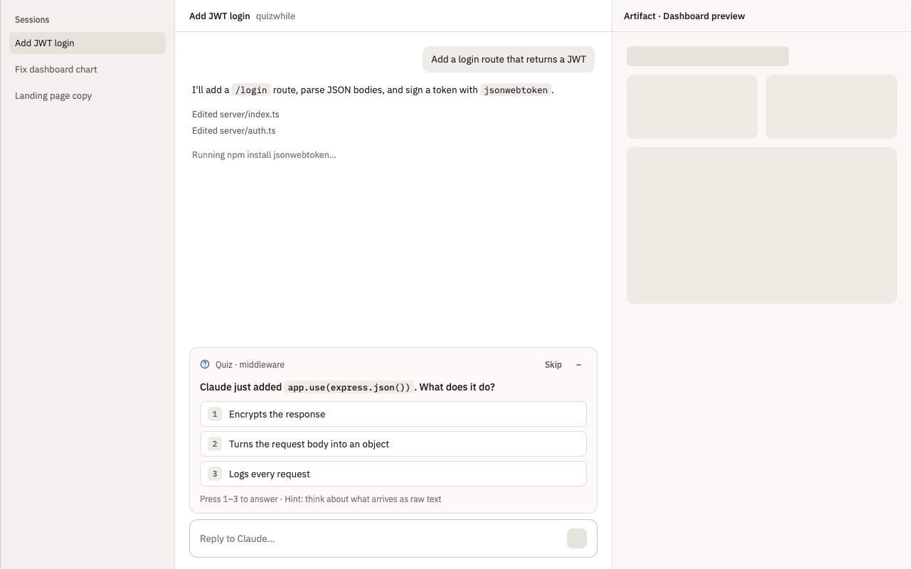

# quizwhile

A Claude Code mod that quizzes you while Claude works. A few seconds into a
turn, a multiple-choice question appears in the band above the prompt, about
your code. Answer it, skip it or collapse it; it steps aside when Claude needs
you and keeps an unanswered question for the next turn.



Every question is about your project's own code, written by Haiku: the
language as your code uses it, what a function or step does, and how the code
connects to outside services. It uses the source files Claude reads and writes
in the project, and before Claude has touched any, a file picked from the
repository (`git ls-files`). Files outside the project are never asked about.
Get one wrong and the file opens in Zed at the line with the answer. Questions
you miss come back later, in the same project.

This first version draws in Claude Code Desktop only.

## Install

In Claude Code, add this repository as a marketplace, then install from it:

```
/plugin marketplace add EdiProdan/quizwhile
```

```
/plugin install quizwhile@quizwhile
```

Then start a new session. The quiz is on by default.

## Commands

- `/quizwhile off` turns it off
- `/quizwhile` turns it back on

## Requirements

- Claude Code Desktop, recent enough to load mods (function hooks)
- Each generated question is a small Haiku call on your account

## Layout

- `hooks/register.tsx`: the hooks module (turn timing, the band, the command)
- `hooks/quiz.ts`: the question type, which files count as source, and the prompt for Haiku
- `tests/band.test.tsx`: tests run by `claude plugin test`
- `.claude-plugin/marketplace.json`: lets `/plugin install` find it in this repository
